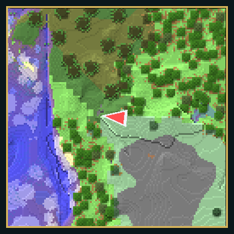
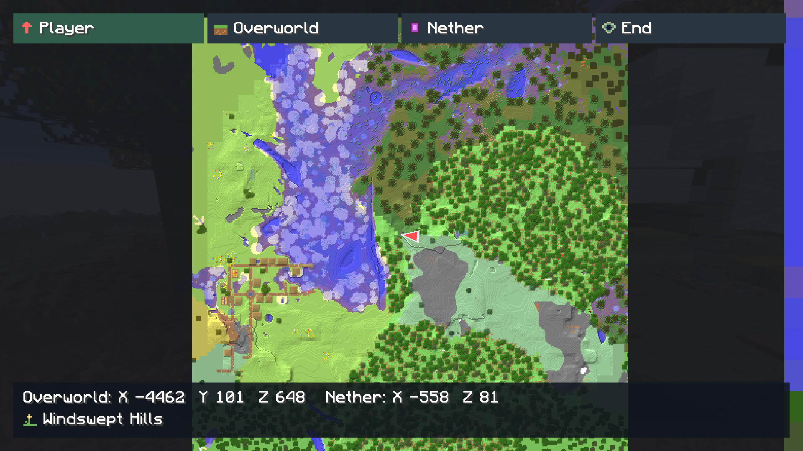
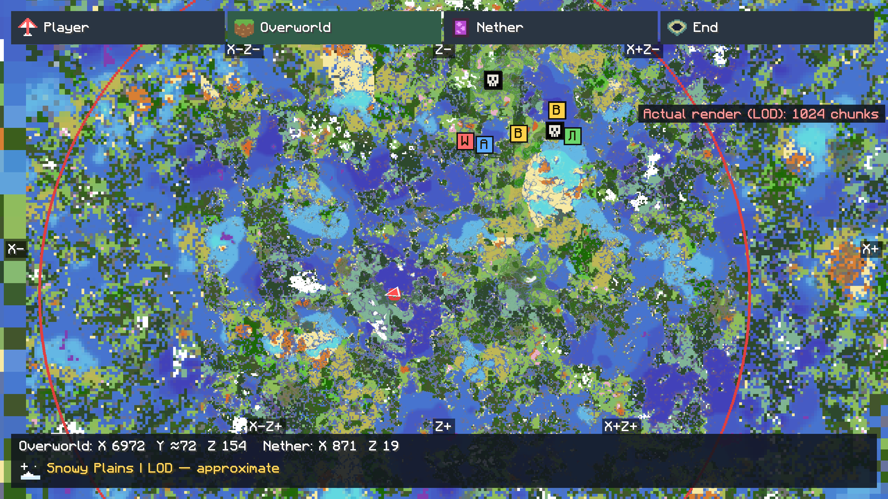
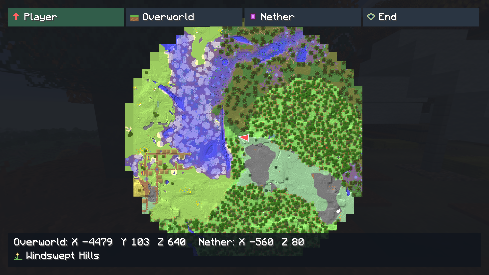
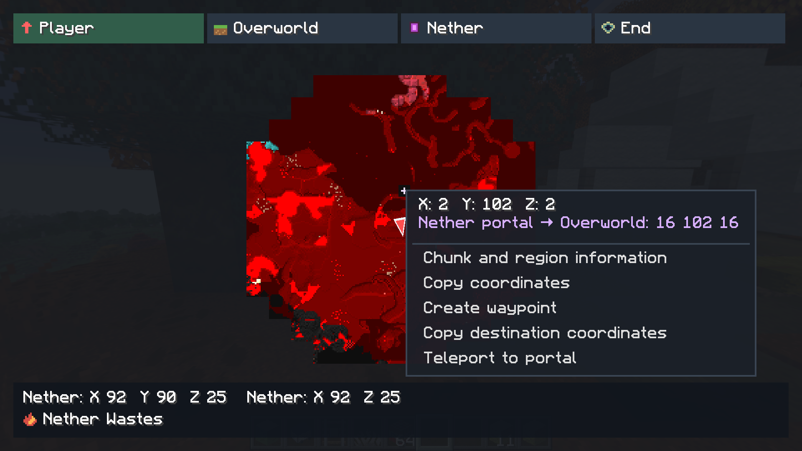
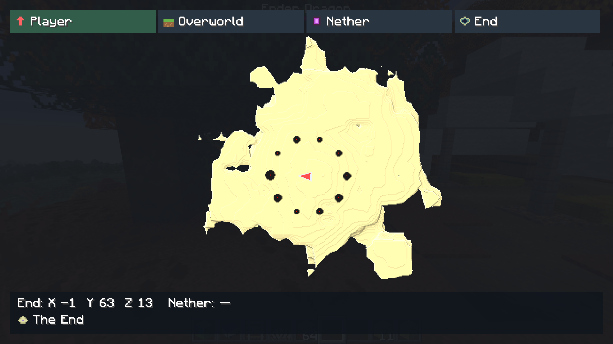
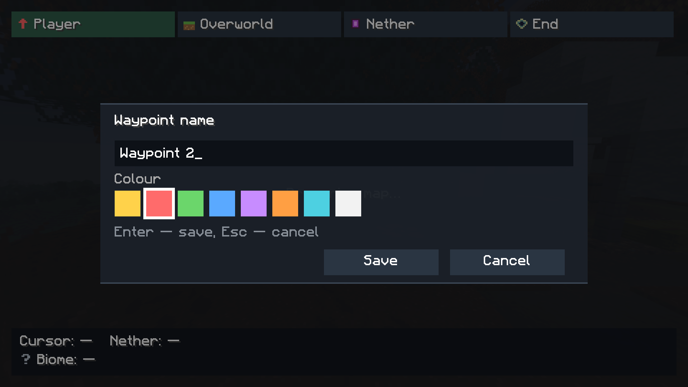
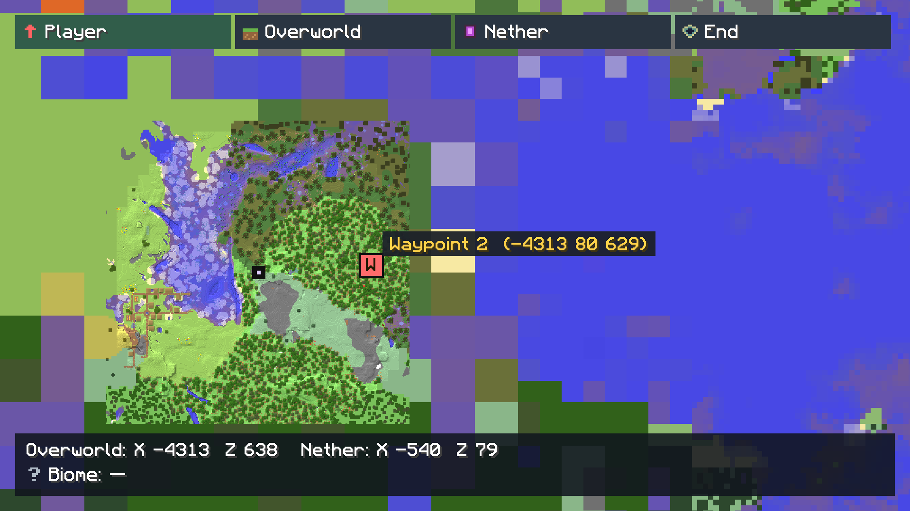

# Minimap, Worldmap and waypoints reworked

A native Horizon mod by daniliammo, continued as [Gurov08ruS](https://github.com/Gurov08ruS).
Version **0.7.0** uses Horizon's signed native SDK and the modern
flat **`.hmod`** format. It includes the cache manager, LOD colour fixes and
configurable two-letter waypoint markers. Earlier **0.6.1** packages use the legacy `.hnmod` format for the older game.
Use the new `.hmod` release with the current launcher. See [CHANGELOG.md](CHANGELOG.md).

<p align="center">
  
</p>

## New in 0.7.0

Version 0.7.0 adds a basic **Map caches** manager, opened from the world map
or the mod's settings while in a world. It lists cache files with their saved
world/server identity, display name, available local icon, size and compatibility
status. Names and icons are read from the local save and saved server list; a
missing icon or removed list entry uses a fallback. Select a file to rebuild its
derived map images without clearing canonical terrain. Refresh updates the list.
Compression and conversion of unsupported container formats remain unavailable.

An **Update cache…** prompt appears when a cache uses an older image revision.
The offer survives ordinary saves/restarts until rebuilding is confirmed. Unknown
newer formats remain untouched and require a compatible mod version; an old
canonical format without a converter cannot be reset or silently converted.
Catalog discovery reads only two headers per file on a separate worker; only
visible icons are copied into GUI pictures. The catalog is loaded on request,
not when joining a world, so discovery does not compete with initial map loading.

LOD colour fixes use a fixed world-space biome blend radius and the same water
opacity policy as ordinary chunks. Mangrove water retains its biome tint at far
zoom. Where thin snow/weather layers are absent from LOD, cold exposed natural
surfaces and canopies receive approximate snow cover, and exposed cold water an
ice colour, using the biome's precipitation, temperature and elevation. Explicit
snow, powder snow, packed/blue ice and artificial blocks retain supplied colours;
ordinary detailed terrain always has priority. Water above an unknown seabed
remains visible. Older LOD colours are updated once fresh Horizon samples arrive;
old coverage remains a fallback until those cells have new data. Historical
terrain unavailable from Horizon cannot be reconstructed by changing the cache.

Waypoint initials can distinguish matching first letters: the default adds the
second letter when the colours are similar; a setting can apply it regardless
of colour or keep one letter. The same abbreviations appear on both maps, in
the waypoint list and in 3D. Colours are considered similar within a fixed RGB
distance of 48; world/dimension and skull icons are kept separate. Initials are
recomputed when points or this setting change, rather than for every marker draw.

The full changes since 0.6.0 are listed in [CHANGELOG.md](CHANGELOG.md).

## Screenshots

### World map



### Long-distance map (1024-chunk LOD distance)



### Whole-map overview



### Nether and portal linking



### The End



### Creating a waypoint



### Waypoint on the map



> Horizon's mod browser shows images from the registry, not from this README.
> `registry/` holds the exact icon, screenshots and entry fragment for
> `horizon-mods`; see `registry/README.md`.

## Install

Requires Horizon Nightly **2026-11-18 · `0b14f8a`**, Minecraft **26.3** and a
launcher with the signed-SDK native route (tested with **0.2.78**).

Download the `.hmod` from [release 0.7.0](https://github.com/Gurov08ruS/Minimap-Worldmap-and-waypoints-reworked/releases/tag/v0.7.0), or build the same source package:

```bash
python3 tools/package.py
```

Import `target/minimap_worldmap_waypoints_reworked-0.7.0.hmod` in the launcher,
enable it for the chosen instance and build that instance's native mods. The
launcher obtains the matching signed SDK and compiles the mod and its function
copies; it does not rebuild Horizon. A `.hnmod` cannot be converted by renaming
its extension. The original data directory, world identities, waypoints and
terrain cache remain in use.

Alternatively, on Linux/macOS or Windows Git Bash:

```bash
./install-horizon.sh --horizon-dir /path/to/instance
./install-horizon.sh --build --instance NAME --launcher /path/to/horizon-launcher
```

The installer atomically installs this mod's `.hmod`, preserves other mods and
bindings, and enables only this mod. It retains a recognized old `.hnmod` as a
`.hnmod.legacy` backup outside the launcher's mod filter. `--instance` uses the
name or ID from `horizon-launcher --json instance list`.

## Release signatures

Release **0.7.0** includes minisign and OpenPGP signatures, signed checksums and
the public verification keys. It uses the same signing keys as earlier releases;
see [SIGNING.md](SIGNING.md). Legacy 0.6.1 artifacts remain available unchanged.

## Language

The interface follows the game language: Russian (`ru_*`), French (`fr_*`),
Spanish (`es_*`) and German (`de_*`) use their respective translations, including regional variants.
All English variants (`en_*`, including Canadian, British, US and Australian
English) share the English translation. Other languages fall back to English. Change the game
language in its language settings. Saved waypoint names are preserved as entered.

## Controls

- The world map fills the viewport. Dimension buttons and cursor information
  float over the terrain on contrasting backgrounds; there is no title bar or
  player-coordinate header. The Nether coordinate line converts the point under
  the mouse from the selected map dimension (Overworld ÷8; Nether unchanged).
  Unsupported dimension conversions are shown as unavailable.
- Right-click a point to outline its 16×16 chunk and 32×32-chunk region. Choose
  **Chunk and region information** to inspect the bounds, height layer, cached
  data source and LOD quality level. LOD data is flagged in yellow, including
  mixed detailed/LOD region coverage. A LOD footprint is counted as a footprint,
  rather than invented detailed chunks. Visit dates are not recorded yet.
- Dimension tabs use original 16×16 pictograms for the player, Overworld, Nether
  and End. Each of the 67 vanilla
  biomes has its own original 16×16 pixel icon, including sulfur caves and the void;
  hover over a waypoint's biome icon for its localized name.
  Each waypoint's biome sample is saved with it in `settings.ini`, so it
  survives chunk unloads, dimension changes and reconnecting. Unavailable or
  unrecognized biome data uses a question mark; no terrain is requested from
  the server to fill it in.
  Detailed terrain retains the sampled biome of each column, independently of
  the game's loaded chunks. The biome is sampled at the visible surface
  (including the top of water), while relief continues to follow the seabed.
  Terrain biome samples are also retained in the world's persistent map container.
- The waypoint manager has a translucent background with menu blur disabled.
- **Overworld coordinates** and **Nether coordinates** independently toggle the
  coordinate lines below the minimap (both default on). X/Z convert by ×8/÷8
  from the player’s actual dimension before rounding down; Y stays unchanged.
  These lines are hidden in the End and custom dimensions, which have no such
  portal mapping. The standalone dimension label below the minimap is removed.
- **N** opens the waypoint manager; **M** opens the world map. **Escape** closes
  the open screen (a name prompt cancels first).
- Rebind **Open world map** and **Waypoints** under **Options → Mods →
  this mod → Settings**. The bindings use Horizon's key assignment and
  persistence, including mouse keys and unbinding; they do not poll a hard-coded
  key.
- Conflicting native assignments are highlighted with the same brackets/style as
  Horizon's other duplicate bindings. Hover shows the conflicting actions,
  including built-in controls and other enabled native mods. Unbound and disabled
  native actions do not create warnings. Built-in binding tooltips also include
  native conflicts.
- While the full-screen map (or its waypoint name prompt) is open, the client
  skips preparing and drawing the 3D world and presents the map interface alone.
  Network traffic, game updates and terrain sampling continue; this does not
  pause the game. Closing the map restores world rendering on the next frame.
  Loading/resource-reload screens and screenshot sequences keep Horizon’s normal
  rendering path.
- Drag the world map with the left mouse button; scroll to zoom at the cursor.
  Panning, zooming, the minimap's follow and the player marker ease between
  frames instead of snapping to mouse steps or server ticks.
- The world map outlines the block under the pointer with a thin black border
  and a translucent white fill. The footer puts the pointed-at coordinates and
  the converted Nether coordinates on one line, with the localised biome on the
  line below. Over water or lava, Y is the liquid surface and the bottom Y of
  the column is shown in parentheses, both there and in the point menu.
- Right-click the world map for a menu at the pointed-at block: **Copy
  coordinates**, **Create waypoint** (the name prompt opens next) and, when the
  client knows the player may run `/tp`, **Teleport here**. The teleport
  entry is hidden without game-master permission (vanilla level 2 or higher).
  Teleporting to another selected dimension uses `/execute in … run tp`.
- The menu also shows **Delete waypoint** when the point is a waypoint. The
  waypoint manager (**N**) lists, edits and deletes waypoints; creation from
  there uses the player's position. **Edit** changes both the name and marker
  colour. Each row shows the first letter in the waypoint's colour, the biome
  beside the name, and the dimension icon beside the dimension text. Death
  waypoints show a skull instead of the letter. Select a waypoint and choose
  **Show on map** to open its dimension and center the map on it without
  teleporting.
- Waypoints are saved with the preferences (newest 64 per world/server). In the
  3D world they appear above the HUD as coloured first-letter markers (or a
  skull for deaths), through walls and only in their own dimension. The marker
  label is configurable: **3D marker** chooses *letter + distance* (default),
  *letter only*, or *name + distance*. **3D labels only on hover** (default on)
  shows that label only while the crosshair is on the marker; turn it off to
  always show it. **Show waypoints in the 3D world** turns
  the whole overlay off, leaving markers only on the maps. Each waypoint can
  also hide its own 3D marker — toggle the `3D` button on its row in the
  waypoint manager or the *Show/Hide in 3D world* entry in the world map's
  right-click menu. On both maps a waypoint's full name appears when hovering
  over its marker.
- **Death waypoints** are placed automatically where the player dies: a black
  marker with a skull, named `Death`, `Death 2`, `Death 3` and so on. Two
  settings control them: **Death waypoints** (create on death, default on) and
  **Remove death waypoints when reached** (default on). Approaching a death
  waypoint within four blocks removes it; the proximity check uses all three
  coordinates and only the player's current dimension. Both options can be
  switched off independently in the mod's settings.
- Nether portals, End portals and End gateways are marked on the map; clicking
  one opens its destination. Nether destinations prefer the nearest known portal
  within the vanilla search radius, otherwise the ×8/÷8 conversion; End portals
  show the End platform and gateways the outer islands.
- World borders are drawn on both the Overworld and Nether maps; the Nether
  border shows the same physical area (÷8). On the player's current dimension,
  the actual far-terrain/LOD render distance and the chunk render distance are
  drawn in the same style. The chunk border follows the full outer chunk edges,
  not a smaller circle. Hover a border to see its label.
- The world map's **Player / Overworld / Nether / End** tabs select its dimension.
- **Minimap dimension** in the mod's settings selects the minimap's dimension
  independently. **Player** follows the player's current dimension on either map.
- The player marker is an arrow pointing in the player’s viewing direction on
  both maps. It stays pointed upward when the minimap rotates with the player.
  The player marker is drawn in every selected dimension. Nether and Overworld
  positions convert by ×8/÷8, the End and Overworld share one scale, and the
  marker is dimmed while the player stands in another dimension.
- Selecting a dimension never teleports the player. An uncached area displays
  **No data**, without substituting the current dimension's terrain.

## Current map implementation

Both views use one background sampler and a persistent repository. One
`cache/<kind>-<readable-name>-<identity-hash>.mwwr` file holds all dimensions and sampled height layers
of a single-player save or server address. The directory is inside Horizon's
mod data folder: `horizon-mods/.horizon-mod-data/minimap_worldmap_waypoints_reworked/`
under the game directory. The exact world identity is checked inside the file;
save and server identities remain separate. Rejoining or restarting the game
restores map data from this file. Server wipes require manual cache clearing;
no automatic server epochs are created. Close the game before manually deleting
its cache file.

Terrain changes are committed in batches at a five-second interval and on
world/dimension changes and normal shutdown. Sampling and disk operations run on
the map worker. A physical dimension change commits pending data before clearing
old terrain, biome snapshots, portal snapshots and the worker's display atlas.
Previously visited dimensions are loaded again when selected on the map.

**Map RAM** in the mod settings is a draggable slider from 16 to 512 MiB,
defaulting to 64 MiB. It budgets retained terrain, the LRU read cache and pending
record bytes; active display/coverage snapshots, queued game snapshots, disk-index
metadata and GPU textures are additional memory. It is not a cap on the whole
game process. Off-screen tiles are evicted and reloaded on demand; large views
stream persistent world-space overview tiles rather than loading the entire explored world.
A write failure pauses sampling and retains accepted unsaved records instead of
evicting them. The map and mod settings expose the error. A busy container is
left untouched and uses a bounded temporary RAM map, with a visible warning.

The initial format uses CRC32C, two recoverable roots, checked index pages and
in-file free-space reuse. It currently stores raw records (codec 0); Zstd,
transactional deletion, compaction and cache deletion controls remain future work.
See [CONTAINER.md](CONTAINER.md) for the format and its current limits.

The map also reads Horizon’s existing CPU LOD columns through an injected adapter.
It neither requests extra terrain nor drives LOD generation. LOD is stored as
16×16-sample footprints with their original extent and stride, only for the surface
layer. It does not substitute surface terrain for caves or Nether underground
layers. Detailed cached chunks always win, including known void; newer LOD never
overwrites them. Unchanged CPU snapshots are ignored; a changed snapshot can fill unknown LOD
cells, while existing samples and all detailed data keep priority. Up to eight
LOD snapshots are queued every 50 ms, prioritizing visible coarse coverage before
local detail. Snapshot identity is tracked independently of RAM coverage so
evicted tiles cannot repeatedly starve distant LOD. The disk repository retains off-screen terrain; RAM retention is budgeted by the Map RAM slider.
Work queues and snapshot submission rates remain bounded. Approximate surface
Y and biome names are retained with LOD samples, independently of Horizon’s
current camera/frustum; approximate heights are marked with `≈`.

The sampler uses ordinary client-loaded chunks and map colours; underground/Nether
views sample below the player's head. Leaf blocks use the mean colour of their
actual game texture multiplied by the same tint source the world applies: oak,
jungle, acacia, dark oak and mangrove follow the biome foliage colour, birch and
spruce keep their fixed shades, and cherry, pale oak and azalea keep their
untinted texture colours. Water uses the biome water colour, lily pads use the
biome grass colour, and vines use the biome foliage colour. Grass, foliage and
water tints are averaged over a small radius, so biome boundaries fade instead
of forming hard bands; LOD tiles blend neighbouring samples in the same way.
The leaf palette follows resource-pack reloads. Translucent columns are composited instead
of stopping at their top block: water (including bubble columns) and the
glass-family blocks (glass, stained glass and panes, ice, copper grates,
honey/slime blocks, tinted glass) keep their map tint as a semi-transparent
overlay over the first opaque block. Water thickens with depth, so shallow water
keeps most of the seabed colour while deep water darkens it in steps; the relief
shading also follows the seabed under the water. Clear glass and panes use a
neutral tint, while stained panes use their dye colour. Scaffolding and cobwebs
are translucent too.

Grass-like ground cover is left out so it does not carpet every pixel: short and
tall grass, ferns, bushes, dead bushes and dry grass are skipped and the terrain
below them is shown. Flowers, crops, saplings, mushrooms, vines and the other
plants use curated colours close to their petals, fruit and stems instead of the
single generic plant green. Render-invisible blocks such as barriers, light
blocks and moving pistons leave no map pixel. Nether portals, End portals and End
gateways are recorded as map features and get their own markers.

Unknown dimensions are not fetched from the server. Visit
history, manual Y selection and rectangle shape remain
future stages in [PLAN.md](PLAN.md).

The displayed camera is eased: drag and zoom targets are approached over a few
frames, zoom keeps the world point under the cursor fixed, and markers interpolate
player positions. Both maps draw world-space tiles through Horizon's portable
HUD renderer. The worker prefetches the camera's destination and zoom level.
Ready coarse coverage remains visible until the required finer tiles are ready;
ready pages also survive terrain-payload eviction. Camera movement changes
geometry immediately, without waiting for sampling or disk reads. Pointer
coordinates and overlays use the same displayed camera.

Derived 16×16 overview tiles are reduced from known terrain and persisted in the
same `.mwwr` container. They distinguish unknown samples from known transparent
void. Original detailed terrain keeps one texel per block when zoomed in, and
canonical Horizon LOD samples keep their original extent and resolution. Wide
views select reduced tiles rather than rasterizing a screen image. Existing
caches build the visual hierarchy in bounded background steps on first use;
subsequent opens read ready visual tiles. Pending rebuilds resume after restart.
No cache clearing is required.

The worker retains stable visual slots and independent 1024×64 GUI texture pages;
unchanged pages keep their textures. A spatial index selects keys by region and
resolution. Sampling, storage and dirty-tile shading use separate bounded worker
stages, and hover metadata is loaded asynchronously. Atlas assembly performs no
disk reads. Both maps use nearest texture sampling and transparent unknown
terrain. The minimap rotates the tile geometry and clips it to its configured
shape. Derived visuals use an additional 32–64 MiB cache target, with bounded
pins for requested coverage; at most 32,768 visual tiles are admitted. Images,
CPU/GPU pages, metadata and overlapping publication generations are additional
to the terrain RAM budget. Slow storage or unavailable game terrain can still
delay new detail; live-game frame latency has not been measured. See
[PERFORMANCE.md](PERFORMANCE.md) for budgets, measurements and remaining work.

Waypoints are stored in the same `settings.ini`, keyed by Horizon's stable world
identity, dimension and X/Z. Single-player saves use the save folder (not the
shown name); servers use the public joined address provided by `NativeWorldId`.
Save and server identities have separate namespaces. Rejoining the same identity
restores its points. Unknown identities cannot create or display points. A server
address alias or a renamed save folder is a different identity; friend invites
have Horizon's public invite identity, which can change between sharings.

Migration deliberately deletes old `waypoint=` records without a world identity,
as requested by the author; it never guesses a destination world. Valid scoped
`waypoint_v2=` records survive with the default marker colour and are rewritten
as `waypoint_v5=` with their colour, a letter icon, an empty biome and 3D
visibility on;
`waypoint_v3=` and `waypoint_v4=` records upgrade the same way on the next save.
Preferences also
survive. The migration is persisted even without joining a world or editing
settings. Each world keeps its newest 64
points; at 4,096 total points new worlds/points are refused rather than evicting
another world's records. Portal
destinations are computed on the client: a Nether portal prefers the nearest
already-sampled portal in the target dimension (128 blocks), otherwise the
vanilla ×8/÷8 coordinates are shown; an End portal shows the End platform
(100, 49, 0) and an End gateway is labelled as the outer islands without a
precise point. The world border is the border the client currently knows; the
Nether map draws the same physical area (÷8).

Minimap options: four corners, square/round, 64–256 GUI-pixel sizes, 0.1–4 blocks
per map pixel, and player rotation. Size follows the client's GUI scale and is
limited to the available viewport. Another provider's active native minimap slot
is respected. The world map and minimap are not drawn simultaneously.

**Direction letters** draw the eight compass points (N, NE, E, SE, S, SW, W, NW,
localized per language) at the inner edge of both maps, rotating with the
minimap so the north marker always points at true north. **Direction style**
switches them to the game's axis names (`Z-`, `X+Z-`, `X+`, `X+Z+`, `Z+`,
`X-Z+`, `X-`, `X-Z-`). Both settings are off/compass by default.

Preferences and waypoints load/save asynchronously in `settings.ini` under the
mod data folder provided by Horizon. Normal exit flushes accepted changes. The running mod writes its settings file, its short-lived settings replacement
file, and one persistent map container per world/server. Containers never use
external journals, lock files or temporary copies. Waypoints remain in the
settings file (bounded to 64 per world/server and 4,096 total). No network
requests are made by the mod.

Both map views use independent GUI picture pages through Horizon’s portable HUD
renderer. The legacy small-image path still uses the shared native RGBA slot.

## Compatibility

- Minecraft Java Edition **26.3**.
- Signed Horizon SDK / Nightly **2026-11-18**, commit
  `0b14f8acfd97fa2c750e42795249dcc981178ca4`.
- SDK Rust **1.99.1**, package format **6**; Horizon Mixins
  `e59da9094f0c2fdda6c627fe9eff22dec6a906f0`, plan schema **6**.

The pins and source hashes are in [compatibility.json](compatibility.json).
Other game revisions require a deliberate port. The shared runtime and game
adapters use portable APIs; the registration path decoder is gated for Unix and
Windows, preserving non-Unicode paths. Linux was exercised with the installed
Nightly; macOS/Windows execution and combinations with other mods remain
unverified. See [VALIDATION.md](VALIDATION.md).

## Build and validate

Use Rust **1.99.1**, Python **3.12+**, the current `cargo-horizon-mod` and Horizon
launcher. The package tool can be built from the pinned Horizon commit in a
separate checkout; do not edit the original game or Mixins checkout. Set
`HORIZON_MOD_TOOL` and `HORIZON_LAUNCHER` to current executables if they are not
on PATH. Local tools also detect the ignored executables used during development.

```bash
cargo fmt --all -- --check
cargo clippy --workspace --all-targets --locked --offline -- -D warnings
cargo test --workspace --locked --offline
python3 tools/test_template.py
python3 tools/horizon.py check --horizon /path/to/read-only/horizon
python3 tools/test_stage.py --horizon /path/to/read-only/horizon
python3 tools/horizon.py test --horizon /path/to/read-only/horizon
python3 tools/package.py
```

`--horizon` is an optional read-only audit of an existing checkout. Native builds
use the signed SDK's committed pinned export, generated function mirrors and
Mixins plan/apply. Build state and the disposable **SDK migration** instance stay
inside ignored `target/`. The tools reuse installed Nightly files through hard
links when available; `--installed-version-dir` supports another installation.
Original worlds and prepared resources are not build destinations.

`runtime.rs` is shared by the standalone library and the SDK mod crate. Four
separate test payloads retain private-scope access in both. `test_template.py`
checks deterministic flat packaging, exact source payloads, localized SDK labels
and an isolated installer/legacy-backup fixture. The native check builds the
actual installed `.hmod`; `test_stage.py` audits its real Mixins output. The SDK
crate tests run against the fetched API source without rebuilding the game.
Archived private-renderer fixtures are documented in `tests/legacy_adapter/` and
are not counted as modern SDK passes. Live GUI checks use the disposable instance
and `examples/sdk_fixture.rs`, not a player's worlds.

To regenerate the SDK label catalog, run `cargo run --example export_settings`
and export its language/key/value rows to `native/assets/<id>/lang/`. The
[validation workflow](.github/workflows/validate.yml) builds the pinned tools,
checks the archive and native adapters, runs both runtime test suites and
uploads source packages and logs. Its new configuration has not yet been run
on GitHub during this local migration.

## License and attribution

[GPL-3.0-only](LICENSE). The MIT-licensed Horizon native mod template and its
Veinminer-derived build tooling are credited in [NOTICE](NOTICE), with their
original permissions preserved in [LICENSE-MIT](LICENSE-MIT).
[Permission for Horizon registry review](NOTICE-REVIEW-PERMISSION.md) accompanies
the distributed sources. This project is not affiliated with Mojang or Microsoft.
