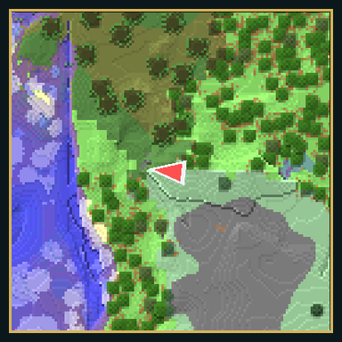
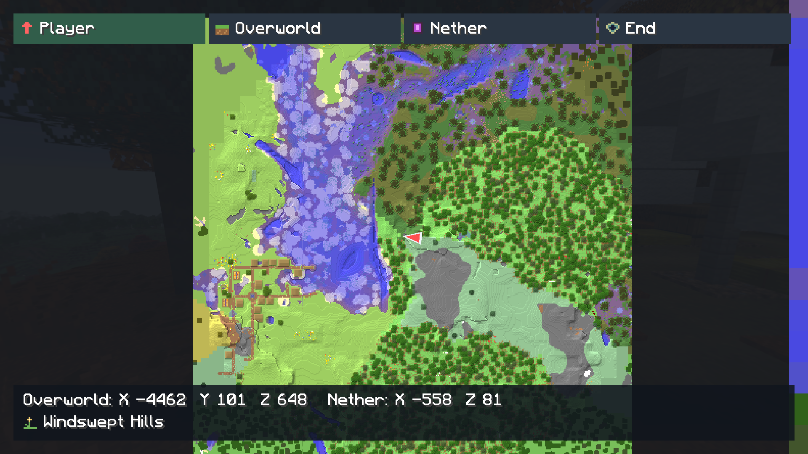
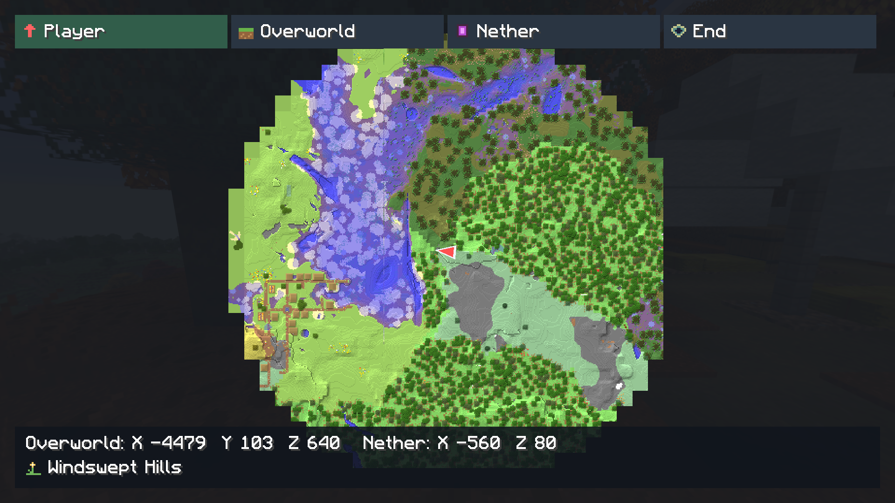
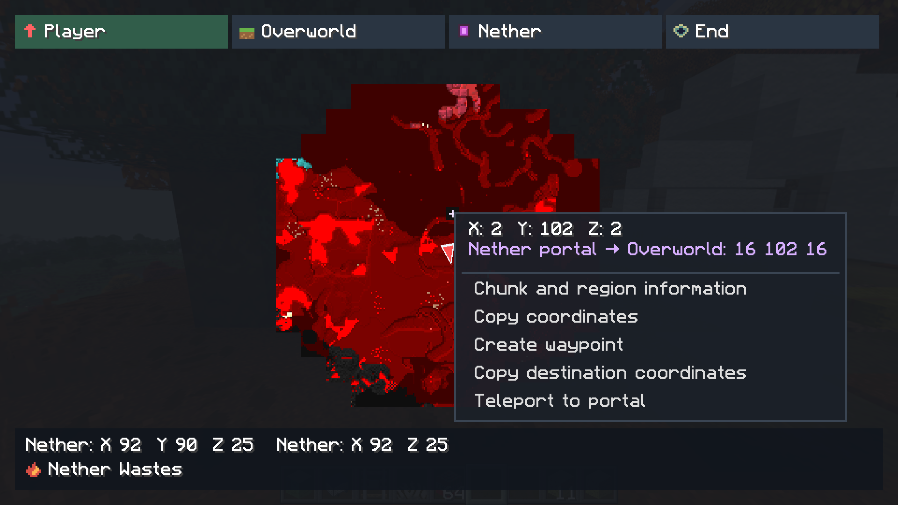
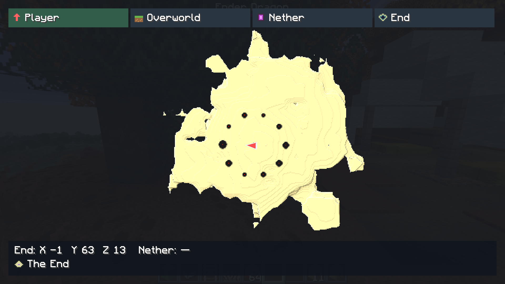
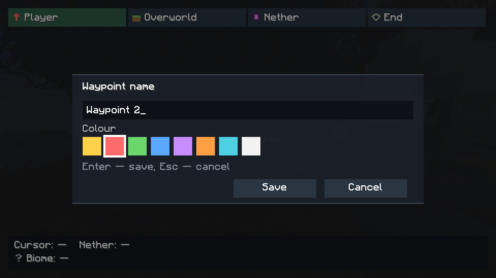
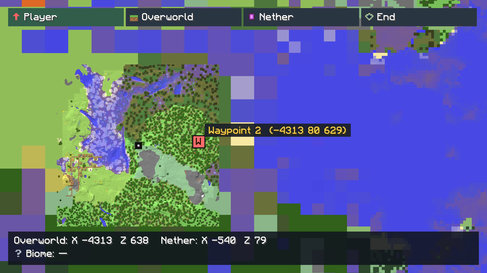

# Minimap, Worldmap and waypoints reworked

A native Horizon mod by daniliammo, continued as [Gurov08ruS](https://github.com/Gurov08ruS).
Version **0.5.1** includes 67 individual biome icons at 16×16, retained biome names
after chunk unload, LOD terrain caching, German localization, coloured waypoints
and Show on map. The full-screen map keeps terrain detail at every zoom and
skips rendering the 3D world behind it.
Old unscoped waypoints from 0.3.x are deleted on first load; preferences remain.

<p align="center">
  
</p>

## Screenshots

### World map



### Whole-map overview



### Nether and portal linking



### The End



### Creating a waypoint



### Waypoint on the map



> Horizon's mod browser shows images from the registry, not from this README.
> `registry/` holds the exact icon, screenshots and entry fragment for
> `horizon-mods`; see `registry/README.md`.

## Install

```bash
./install-horizon.sh
```

The Bash installer packages the current sources, atomically installs the `.hnmod`
in `~/.local/share/horizon/horizon-native-mods/`, and enables this mod in
`horizon-mods.txt`. It preserves other mods and key assignments. It does not
compile or launch the game by default. Use `--horizon-dir /path/to/game` for
another game folder. It runs on Linux and macOS (Bash 3.2 or newer); on Windows,
build `python3 tools/package.py` and import the resulting `.hnmod` in the
launcher, or run the script in Git Bash.

Optional native build through the launcher:

```bash
./install-horizon.sh --build --instance NAME
```

Use the instance's name or ID from `horizon-launcher --json instance list`.
The installer resolves and validates that instance's game directory and builds
its installed native mod set. `--launcher /path/to/horizon-launcher` selects a
launcher executable. A source `.hnmod` needs one game build before it can run.
The script does not update a published release or registry entry.

## Release signatures

Download the `.hnmod` and its matching `.hnmod.minisig` from this repository's
[releases](https://github.com/Gurov08ruS/Minimap-Worldmap-and-waypoints-reworked/releases).
Packages are signed with minisign; release commits and tags use the original
GPG signing key. See [SIGNING.md](SIGNING.md) for verification commands and the
GPG-signed minisign public key.

## Language

The interface follows the game language: Russian (`ru_*`), French (`fr_*`),
Spanish (`es_*`) and German (`de_*`) use their respective translations, including regional variants.
All English variants (`en_*`, including Canadian, British, US and Australian
English) share the English translation. Other languages fall back to English. Change the game
language in its language settings. Saved waypoint names are preserved as entered.

## Controls

- The world map fills the viewport. Dimension buttons and cursor information
  float over the terrain on contrasting backgrounds; there is no title bar or
  player-coordinate header. The Nether coordinate line converts the point under
  the mouse from the selected map dimension (Overworld ÷8; Nether unchanged).
  Unsupported dimension conversions are shown as unavailable.
- Right-click a point to outline its 16×16 chunk and 32×32-chunk region. Choose
  **Chunk and region information** to inspect the bounds, height layer, cached
  data source and LOD quality level. LOD data is flagged in yellow, including
  mixed detailed/LOD region coverage. A LOD footprint is counted as a footprint,
  rather than invented detailed chunks. Visit dates are not recorded yet.
- Dimension tabs use original 16×16 pictograms for the player, Overworld, Nether
  and End. Each of the 67 vanilla
  biomes has its own original 16×16 pixel icon, including sulfur caves and the void;
  hover over a waypoint's biome icon for its localized name.
  Each waypoint's biome sample is saved with it in `settings.ini`, so it
  survives chunk unloads, dimension changes and reconnecting. Unavailable or
  unrecognized biome data uses a question mark; no terrain is requested from
  the server to fill it in.
  Detailed terrain retains the sampled biome of each column, independently of
  the game's loaded chunks. The biome is sampled at the visible surface
  (including the top of water), while relief continues to follow the seabed.
  Terrain biome samples are also retained in the world's persistent map container.
- The waypoint manager has a translucent background with menu blur disabled.
- **Overworld coordinates** and **Nether coordinates** independently toggle the
  coordinate lines below the minimap (both default on). X/Z convert by ×8/÷8
  from the player’s actual dimension before rounding down; Y stays unchanged.
  These lines are hidden in the End and custom dimensions, which have no such
  portal mapping. The standalone dimension label below the minimap is removed.
- **N** opens the waypoint manager; **M** opens the world map. **Escape** closes
  the open screen (a name prompt cancels first).
- Rebind **Open world map** and **Waypoints** under **Options → Mods →
  this mod → Settings**. The bindings use Horizon's key assignment and
  persistence, including mouse keys and unbinding; they do not poll a hard-coded
  key.
- Conflicting native assignments are highlighted with the same brackets/style as
  Horizon's other duplicate bindings. Hover shows the conflicting actions,
  including built-in controls and other enabled native mods. Unbound and disabled
  native actions do not create warnings. Built-in binding tooltips also include
  native conflicts.
- While the full-screen map (or its waypoint name prompt) is open, the client
  skips preparing and drawing the 3D world and presents the map interface alone.
  Network traffic, game updates and terrain sampling continue; this does not
  pause the game. Closing the map restores world rendering on the next frame.
  Loading/resource-reload screens and screenshot sequences keep Horizon’s normal
  rendering path.
- Drag the world map with the left mouse button; scroll to zoom at the cursor.
  Panning, zooming, the minimap's follow and the player marker ease between
  frames instead of snapping to mouse steps or server ticks.
- The world map outlines the block under the pointer with a thin black border
  and a translucent white fill. The footer puts the pointed-at coordinates and
  the converted Nether coordinates on one line, with the localised biome on the
  line below. Over water or lava, Y is the liquid surface and the bottom Y of
  the column is shown in parentheses, both there and in the point menu.
- Right-click the world map for a menu at the pointed-at block: **Copy
  coordinates**, **Create waypoint** (the name prompt opens next) and, when the
  client knows the player may run `/tp`, **Teleport here**. The teleport
  entry is hidden without game-master permission (vanilla level 2 or higher).
  Teleporting to another selected dimension uses `/execute in … run tp`.
- The menu also shows **Delete waypoint** when the point is a waypoint. The
  waypoint manager (**N**) lists, edits and deletes waypoints; creation from
  there uses the player's position. **Edit** changes both the name and marker
  colour. Each row shows the first letter in the waypoint's colour, the biome
  beside the name, and the dimension icon beside the dimension text. Death
  waypoints show a skull instead of the letter. Select a waypoint and choose
  **Show on map** to open its dimension and center the map on it without
  teleporting.
- Waypoints are saved with the preferences (newest 64 per world/server). In the
  3D world they appear above the HUD as coloured first-letter markers with their
  name and distance, through walls and only in their own dimension. On both maps
  their full name appears when hovering over the marker.
- **Death waypoints** are placed automatically where the player dies: a black
  marker with a skull, named `Death`, `Death 2`, `Death 3` and so on. Two
  settings control them: **Death waypoints** (create on death, default on) and
  **Remove death waypoints when reached** (default on). Approaching a death
  waypoint within four blocks removes it; the proximity check uses all three
  coordinates and only the player's current dimension. Both options can be
  switched off independently in the mod's settings.
- Nether portals, End portals and End gateways are marked on the map; clicking
  one opens its destination. Nether destinations prefer the nearest known portal
  within the vanilla search radius, otherwise the ×8/÷8 conversion; End portals
  show the End platform and gateways the outer islands.
- World borders are drawn on both the Overworld and Nether maps; the Nether
  border shows the same physical area (÷8). On the player's current dimension,
  the actual far-terrain/LOD render distance and the chunk render distance are
  drawn in the same style. The chunk border follows the full outer chunk edges,
  not a smaller circle. Hover a border to see its label.
- The world map's **Player / Overworld / Nether / End** tabs select its dimension.
- **Minimap dimension** in the mod's settings selects the minimap's dimension
  independently. **Player** follows the player's current dimension on either map.
- The player marker is an arrow pointing in the player’s viewing direction on
  both maps. It stays pointed upward when the minimap rotates with the player.
  The player marker is drawn in every selected dimension. Nether and Overworld
  positions convert by ×8/÷8, the End and Overworld share one scale, and the
  marker is dimmed while the player stands in another dimension.
- Selecting a dimension never teleports the player. An uncached area displays
  **No data**, without substituting the current dimension's terrain.

## Current map implementation

Both views use one background sampler and a persistent repository. One
`cache/<world-id-hash>.mwwr` file holds all dimensions and sampled height layers
of a single-player save or server address. The directory is inside Horizon's
mod data folder: `horizon-mods/.horizon-mod-data/minimap_worldmap_waypoints_reworked/`
under the game directory. The exact world identity is checked inside the file;
save and server identities remain separate. Rejoining or restarting the game
restores map data from this file. Server wipes require manual cache clearing;
no automatic server epochs are created. Close the game before manually deleting
its cache file.

Terrain changes are committed in batches at a five-second interval and on
world/dimension changes and normal shutdown. Sampling and disk operations run on
the map worker. A physical dimension change commits pending data before clearing
old terrain, biome snapshots, portal snapshots and the worker's display atlas.
Previously visited dimensions are loaded again when selected on the map.

**Map RAM** in the mod settings is a draggable slider from 16 to 512 MiB,
defaulting to 64 MiB. It budgets retained terrain, the LRU read cache and pending
record bytes; active display/coverage snapshots, queued game snapshots, disk-index
metadata and GPU textures are additional memory. It is not a cap on the whole
game process. Off-screen tiles are evicted and reloaded on demand; large views
use a paged raster fallback rather than loading the entire explored world.
A write failure pauses sampling and retains accepted unsaved records instead of
evicting them. The map and mod settings expose the error. A busy container is
left untouched and uses a bounded temporary RAM map, with a visible warning.

The initial format uses CRC32C, two recoverable roots, checked index pages and
in-file free-space reuse. It currently stores raw records (codec 0); Zstd,
transactional deletion, compaction and cache-manager controls remain future work.
See [CONTAINER.md](CONTAINER.md) for the format and its current limits.

The map also reads Horizon’s existing CPU LOD columns through an injected adapter.
It neither requests extra terrain nor drives LOD generation. LOD is stored as
16×16-sample footprints with their original extent and stride, only for the surface
layer. It does not substitute surface terrain for caves or Nether underground
layers. Detailed cached chunks always win, including known void; newer LOD never
overwrites them. Unchanged CPU snapshots are ignored; a changed snapshot can fill unknown LOD
cells, while existing samples and all detailed data keep priority. Up to four
LOD snapshots are queued every 250 ms, prioritizing the map camera. The disk repository retains off-screen terrain; RAM retention is budgeted by the Map RAM slider.
Work queues and snapshot submission rates remain bounded. Approximate surface
Y and biome names are retained with LOD samples, independently of Horizon’s
current camera/frustum; approximate heights are marked with `≈`.

The sampler uses ordinary client-loaded chunks and map colours; underground/Nether
views sample below the player's head. Leaf blocks use the mean colour of their
actual game texture multiplied by the same tint source the world applies: oak,
jungle, acacia, dark oak and mangrove follow the biome foliage colour, birch and
spruce keep their fixed shades, and cherry, pale oak and azalea keep their
untinted texture colours. Water uses the biome water colour, lily pads use the
biome grass colour, and vines use the biome foliage colour. Grass, foliage and
water tints are averaged over a small radius, so biome boundaries fade instead
of forming hard bands; LOD tiles blend neighbouring samples in the same way.
The leaf palette follows resource-pack reloads. Translucent columns are composited instead
of stopping at their top block: water (including bubble columns) and the
glass-family blocks (glass, stained glass and panes, ice, copper grates,
honey/slime blocks, tinted glass) keep their map tint as a semi-transparent
overlay over the first opaque block. Water thickens with depth, so shallow water
keeps most of the seabed colour while deep water darkens it in steps; the relief
shading also follows the seabed under the water. Clear glass and panes use a
neutral tint, while stained panes use their dye colour. Scaffolding and cobwebs
are translucent too.

Grass-like ground cover is left out so it does not carpet every pixel: short and
tall grass, ferns, bushes, dead bushes and dry grass are skipped and the terrain
below them is shown. Flowers, crops, saplings, mushrooms, vines and the other
plants use curated colours close to their petals, fruit and stems instead of the
single generic plant green. Render-invisible blocks such as barriers, light
blocks and moving pistons leave no map pixel. Nether portals, End portals and End
gateways are recorded as map features and get their own markers.

Unknown dimensions are not fetched from the server. Visit
history, manual Y selection and rectangle shape remain
future stages in [PLAN.md](PLAN.md).

The displayed camera is eased: drag and zoom targets are approached over a few
frames, zoom keeps the world point under the cursor fixed, and markers interpolate
player positions. The large map draws block-resolution chunk tiles as clipped,
textured GPU quads through Horizon's existing HUD pipeline. Moving or zooming
within the uploaded coverage changes only geometry. There are no zoom-dependent
texture detail levels. When a wider area is needed, the camera continues moving immediately; newly
exposed areas appear when their terrain is ready. Raster fallback also reprojects
the existing image during pan and zoom without waiting for the worker. Pointer coordinates
and overlays use that same displayed camera. Texture uploads and their matching
geometry are published together; a failed upload preserves the previous frame.

The worker prepares colours and relief shading once per block when the terrain
repository changes. Up to 4,096 tiles fit in the existing 1024×1024 RGBA slot
(4 MiB); the current implementation rebuilds/uploads the selected layer's atlas
when its data or padded visible coverage changes. Camera movement inside that
coverage reuses it. Off-screen data stays in the world container and is read on demand. If visible entries exceed the
1024×1024 GPU slot, a worker raster fallback presents the retained data without
truncating the cache; extreme views can therefore cost more CPU. The minimap retains its
CPU renderer for rotation and circular masking. Nearest texture sampling keeps
block boundaries sharp; unknown terrain is transparent. Detailed chunks keep one
texel per block and LOD textures keep their original sample resolution at every
zoom. Distant smoothing and its setting have been removed; legacy
`smooth_worldmap` preferences are ignored. Each presentation atlas uses up to
4 MiB of pixels, with old and new generations briefly coexisting during upload.
These presentation limits are separate from the terrain RAM setting. Relief reads neighbouring
chunks to preserve lighting across tile edges. See [PERFORMANCE.md](PERFORMANCE.md)
for measurements, limitations and further optimization options.

Waypoints are stored in the same `settings.ini`, keyed by Horizon's stable world
identity, dimension and X/Z. Single-player saves use the save folder (not the
shown name); servers use the public joined address provided by `NativeWorldId`.
Save and server identities have separate namespaces. Rejoining the same identity
restores its points. Unknown identities cannot create or display points. A server
address alias or a renamed save folder is a different identity; friend invites
have Horizon's public invite identity, which can change between sharings.

Migration deliberately deletes old `waypoint=` records without a world identity,
as requested by the author; it never guesses a destination world. Valid scoped
`waypoint_v2=` records survive with the default marker colour and are rewritten
as `waypoint_v4=` with their colour, a letter icon and an empty biome;
`waypoint_v3=` records upgrade the same way on the next save. Preferences also
survive. The migration is persisted even without joining a world or editing
settings. Each world keeps its newest 64
points; at 4,096 total points new worlds/points are refused rather than evicting
another world's records. Portal
destinations are computed on the client: a Nether portal prefers the nearest
already-sampled portal in the target dimension (128 blocks), otherwise the
vanilla ×8/÷8 coordinates are shown; an End portal shows the End platform
(100, 49, 0) and an End gateway is labelled as the outer islands without a
precise point. The world border is the border the client currently knows; the
Nether map draws the same physical area (÷8).

Minimap options: four corners, square/round, 64–256 GUI-pixel sizes, 0.1–4 blocks
per map pixel, and player rotation. Size follows the client's GUI scale and is
limited to the available viewport. Another provider's active native minimap slot
is respected. The world map and minimap are not drawn simultaneously.

Preferences and waypoints load/save asynchronously in `settings.ini` under the
mod data folder provided by Horizon. Normal exit flushes accepted changes. The running mod writes its settings file, its short-lived settings replacement
file, and one persistent map container per world/server. Containers never use
external journals, lock files or temporary copies. Waypoints remain in the
settings file (bounded to 64 per world/server and 4,096 total). No network
requests are made by the mod.

The two views use Horizon's shared native RGBA atlas slot. Mods that independently
write that same global slot may require integration to coexist; this release does
not add a new engine texture allocator.

## Compatibility

- Minecraft Java Edition **26.3**, through Horizon.
- Horizon Nightly **2026-11-07**, commit
  `2ebf00a0281c592f79191e76fce0e7d522c6f425`.
- Horizon Mixins `d9c83d7096b7ea5b83678da2efdfd6161f74997e` (schema 6).

These revisions are pinned in [compatibility.json](compatibility.json) and the
mixin manifest. Other revisions and combinations with other mods are not claimed
compatible. See [VALIDATION.md](VALIDATION.md) for check results and practical
limits. The native mod and its injected runtime use only portable Rust standard
library APIs, with no Linux-specific calls, and are intended to build and run on
Linux, macOS and Windows. The running game has only been exercised on Linux in
these checks, so macOS/Windows remain unverified.

The Bash installer targets Linux and macOS; on Windows, install the `.hnmod` with
the Horizon launcher. The Python validation tooling takes a platform lock with
`flock` on Unix and `msvcrt.locking` on Windows.

## Build and validate

Use Rust **1.95.0**, Python **3.12+**, Git, and separate Horizon and Horizon Mixins
checkouts. The runtime and Python tooling use portable APIs (the tooling locks
with `flock` on Unix and `msvcrt` on Windows). `HORIZON_MIXINS` may point to
a separate checkout at the exact Mixins revision above. The Horizon checkout must
contain the pinned commit; staging exports only committed sources into ignored
`target/` trees and never changes the checkout or player resources.

```sh
cargo fetch --locked
cargo fmt --all --check
cargo clippy --workspace --all-targets --locked --offline -- -D warnings
cargo test --workspace --locked --offline
python3 tools/test_template.py
python3 tools/test_stage.py --horizon ../horizon
python3 tools/horizon.py stage --horizon ../horizon
cargo fetch --locked --manifest-path target/mixins/modded/Cargo.toml
python3 tools/horizon.py check --horizon ../horizon
python3 tools/horizon.py test --horizon ../horizon
python3 tools/package.py
```

Fetch the pinned Mixins checkout's dependencies with `cargo fetch --locked`
before the offline checks. The output is
`target/minimap_worldmap_waypoints_reworked-0.5.1.hnmod`.
Check it with `cargo horizon-mod check <file>` using Horizon's official
`cargo-horizon-mod` tool. The [validation workflow](.github/workflows/validate.yml)
runs the standalone tests, source audit, real client check and tests, and official
package check on the pinned source. It uploads the bundle and check logs.

A native mod is injected into `horizon-client`, so after any mod edit the
launcher recompiles that one large crate; Cargo cannot split a single crate
across processes, and Rust's parallel frontend is nightly-only while Horizon
pins stable Rust. The `fast` profile still uses 16 codegen units, so codegen is
parallel, but the frontend and link are not. For iterative builds select the
launcher's **Dev** native profile (`horizon-launcher settings native-profile dev`
or `horizon-launcher native-build --profile dev`), which the launcher documents
as about six times faster to rebuild at some gameplay cost; keep Performance for
playing. `python3 tools/horizon.py check` type-checks the real client without
codegen or linking and is the quickest edit loop.

## License and attribution

[GPL-3.0-only](LICENSE). The MIT-licensed Horizon native mod template and its
Veinminer-derived build tooling are credited in [NOTICE](NOTICE), with their
original permissions preserved in [LICENSE-MIT](LICENSE-MIT).
[Permission for Horizon registry review](NOTICE-REVIEW-PERMISSION.md) accompanies
the distributed sources. This project is not affiliated with Mojang or Microsoft.
